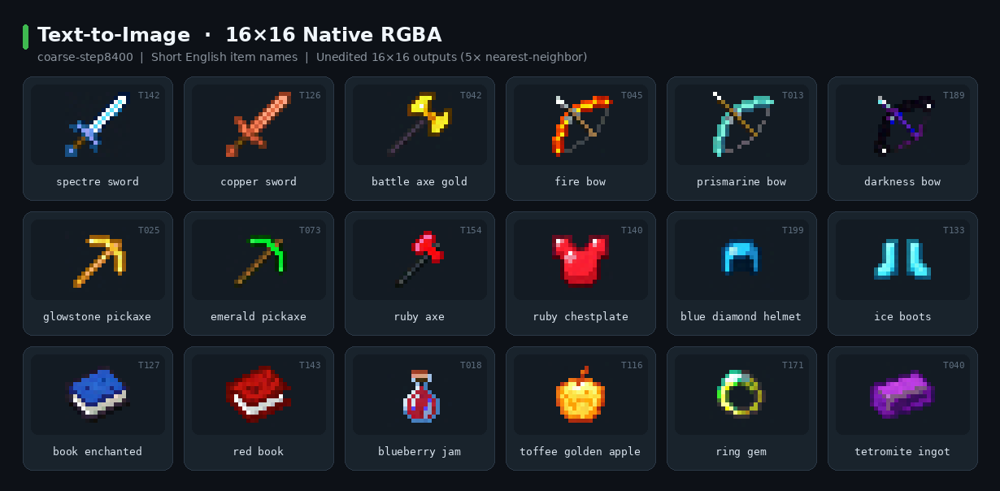
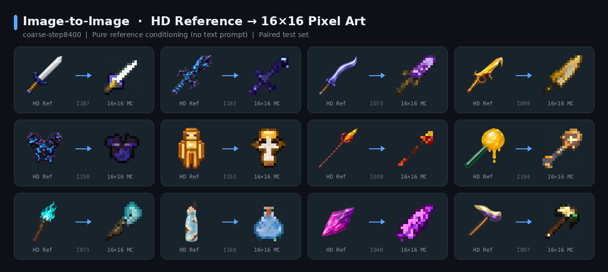
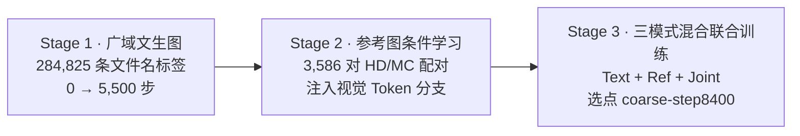

<div align="center">

# MC Gen 2.0

**原生 16×16 RGBA Minecraft 风格物品纹理生成模型**  
*Pixel-Space Rectified Flow Transformer for Minecraft Item Textures*

[](https://www.python.org/)
[](https://pytorch.org/)
[](checkpoints/selected.json)
[](https://huggingface.co/datasets/Risposta/MC_Gen/tree/main/checkpoints/coarse-step8400)
[](https://huggingface.co/datasets/Risposta/MC_Gen)
[](#声明与引用)

[生成效果](#-生成效果) · [核心特性](#-核心特性) · [快速开始](#-快速开始) · [模型规格与指标](#-模型规格与指标) · [训练数据](#-训练数据与策略) · [文档导航](#-文档与资源)

</div>

<br>

**MC Gen 2.0** 支持使用**英文物品名**、**高清参考图**，或**两者结合**，直接生成原生 **16×16 RGBA** 透明背景的 Minecraft 风格物品纹理。提示词可以从 `diamond sword`、`fire bow`、`poison apple`、`ruby chestplate` 这类简洁的英文名称开始。

| 版本 | 条件编码方式 | 使用场景 |
| --- | --- | --- |
| [本地版 · coarse-step8400](https://huggingface.co/datasets/Risposta/MC_Gen/tree/main/checkpoints/coarse-step8400) | 本机 Qwen3-VL-Embedding-8B 提取文本和视觉 token | 离线生成 |
| [API 版 · api-step11516](https://huggingface.co/datasets/Risposta/MC_Gen/tree/main/checkpoints/api-step11516) | 北京百炼 `qwen3-vl-embedding` 分别返回文字和参考图的 2560 维向量 | 本机仅运行 MC 生成器 |



---

## ✨ 核心特性

- **原生 16×16 像素空间生成**：采用 Pixel-Space Rectified Flow Transformer，直接输出原生 16×16 Straight-RGBA 图像。
- **单权重三模式统一**：同一份 `coarse-step8400` 权重同时支持 **纯文生图（Text-to-Image）**、**纯参考图风格化（Image-to-Image）** 与 **图文联合生成（Text + Reference）**，文本与视觉引导强度可独立调节。
- **轻量生成器 + 冻结多模态编码器**：生成器本体仅 **86.7M 参数（~331 MB）**，搭配冻结的 `Qwen3-VL-Embedding-8B` 提取文本语义与高清参考图视觉 token。

---

## 🎨 生成效果

### 1. 文生图（Text-to-Image）

顶部展示图精选自广域验证集短英文提示词的原生 16×16 生成结果（仅做 5× 最近邻放大以便预览，未经过任何人工修图或后处理），覆盖武器、工具、护甲、书籍、食物、宝石与矿锭等多种 Minecraft 物品类别。

### 2. 图生图（Image-to-Image · HD Reference → 16×16 MC）

仅输入高清参考图（不提供文字提示词），模型即可将高清物品原画自动转译为 16×16 Minecraft 像素风格，保留主体朝向、配色与关键结构：
目前单图生成能力不够好，请尽量使用图文联合生成的方式。



---

## 🚀 快速开始

### 本地编码器版

#### 1. 安装依赖

需要 Python `>= 3.11` 与 PyTorch `>= 2.4`（推荐 CUDA 环境）：

```bash
git clone https://github.com/jurky123/MC_Gen2.0.git
cd MC_Gen2.0
pip install -e '.[embedding]'
```

#### 2. 下载模型权重与冻结编码器

在项目根目录下载当前推荐的生成器权重 `coarse-step8400`（约 331 MB）以及冻结多模态编码器 `Qwen3-VL-Embedding-8B`：

```bash
# 下载生成器推理权重
curl -fL --create-dirs -o checkpoints/mcgen-coarse-step8400.pt \
  https://huggingface.co/datasets/Risposta/MC_Gen/resolve/main/checkpoints/coarse-step8400/mcgen-coarse-step8400.pt

# 下载冻结编码器并指定路径
python scripts/download_qwen_vl_embedding.py --out ../Qwen3-VL-Embedding-8B
export MCGEN_EMBEDDING_MODEL=../Qwen3-VL-Embedding-8B
```

#### 3. 运行推理

#### 文生图（Text-to-Image）

```bash
mcgen sample \
  --checkpoint checkpoints/mcgen-coarse-step8400.pt \
  --prompt 'diamond sword' \
  --steps 32 --text-scale 2 --seed 42 \
  --device cuda:0 --out outputs/sword.png
```

#### 图文联合生成（Text + HD Reference）

```bash
mcgen sample \
  --checkpoint checkpoints/mcgen-coarse-step8400.pt \
  --prompt 'ruby battle axe' \
  --reference path/to/item.png \
  --conditioning-mode visual_tokens \
  --steps 32 --text-scale 1 --ref-scale 1 --seed 42 \
  --device cuda:0 --out outputs/axe_joint.png
```

#### 纯参考图风格化（Image-to-Image）

省略 `--prompt` 即可仅依据高清参考图生成 16×16 像素纹理：

```bash
mcgen sample \
  --checkpoint checkpoints/mcgen-coarse-step8400.pt \
  --reference path/to/item.png \
  --conditioning-mode visual_tokens \
  --steps 32 --text-scale 1 --ref-scale 1 --seed 42 \
  --device cuda:0 --out outputs/item_ref.png
```

> [!TIP]
> - **预览放大导出**：默认输出原生 `16×16` RGBA PNG；如需直接查看清晰放大图，可追加 `--export-scale 8`（最近邻放大）。
> - **显存优化**：若 GPU 显存紧张，可追加 `--text-device cpu` 将冻结的 Qwen 编码器放在 CPU 上运行。
> - **提示词建议**：推荐使用简洁的英文物品名（如 `poison apple`、`ghost boots`、`emerald pickaxe`、`book enchanted`）。
> - **HTTP API 与冒烟测试**：可使用 `mcgen serve --checkpoint checkpoints/mcgen-coarse-step8400.pt --device cuda:0 --port 8000` 启动 FastAPI 服务，或运行 `mcgen smoke --out outputs/smoke` 做纯 CPU 端到端验证。

### 百炼 API 版

生成器仍在本机运行。新提示词和参考图会发往北京百炼进行向量化，结果缓存在 `.cache/mcgen-api/`。百炼按账号用量计费。本版下载一个推理文件即可，文件已包含生成器与适配器。

在项目根目录执行以下命令。请先在运行环境中设置北京地域的 `DASHSCOPE_API_KEY`。

```bash
pip install -e .
curl -fL --create-dirs -o checkpoints/mcgen-api-step11516.pt \
  https://huggingface.co/datasets/Risposta/MC_Gen/resolve/main/checkpoints/api-step11516/mcgen-api-step11516.pt

# 文生图
python scripts/sample_api.py --checkpoint checkpoints/mcgen-api-step11516.pt \
  --prompt 'diamond sword' --seed 42 --out outputs/api-sword.png

# 图文联合；仅用参考图时省略 --prompt
python scripts/sample_api.py --checkpoint checkpoints/mcgen-api-step11516.pt \
  --prompt 'ruby battle axe' --reference path/to/item.png --out outputs/api-axe.png
```

默认使用 `cuda:0` 和 24 步 Heun 采样；CPU 推理可加 `--device cpu`。在 263 个配对测试目标上，API 版的编码空间 MAE 为纯文字 **0.3691**、纯参考图 **0.3223**、图文联合 **0.3120**（越低越好）。

---

## 📊 模型规格与指标

### 本地编码器版权重信息

| 项目 | 参数 / 说明 |
| --- | --- |
| **推荐权重** | `coarse-step8400`（`best_mixed_validation`） |
| **模型架构** | Pixel-Space Rectified Flow Transformer（无 VAE） |
| **生成器参数量** | `86,668,292`（**86.7M**） |
| **推理文件大小** | `347,404,954` bytes（**~331 MB**） |
| **冻结编码器** | [`Qwen/Qwen3-VL-Embedding-8B`](https://huggingface.co/Qwen/Qwen3-VL-Embedding-8B) |
| **输出规格** | 原生 `16×16` Straight RGBA PNG |
| **默认采样器** | Heun（32 steps，亦支持 Euler） |
| **SHA-256** | `d354d4ccd6e48bebc124e0ebd5757af0d038f8579569b07171e8acc572f1a93f` |

### 本地编码器版配对测试结果

在 **263 个高清 / MC 配对测试目标** 上的轮廓一致性评测（`--steps 32`，参考图模式采用 `--text-scale 1 --ref-scale 1`）：

| 生成模式 | 输入条件 | 轮廓 IoU（Silhouette IoU） | 说明 |
| --- | --- | :---: | --- |
| **图文联合（Joint）** | 英文短名 + 高清参考图 | **0.661** | 轮廓与目标最接近，兼顾结构与语义 |
| **纯参考图（Reference）** | 仅高清参考图 | **0.639** | 无需文字即可还原主体轮廓与色彩 |
| **纯文字（Text）** | 仅英文短名 | **0.556** | 短名称对应多种合理外观，此指标衡量与单一配对目标的接近度 |

---

## 📦 训练数据与策略

本地编码器版生成器完全**从零训练**，训练分为三个阶段：



- **广域文生图数据**：**284,825** 条清理后的文件名粗标签样本，覆盖大规模 Minecraft 物品材质、颜色与造型先验。
- **高清 / MC 配对数据**：**3,586** 个高质量配对训练目标。高清图使用GPT-image生成。

---

## 📚 文档与资源

| 资源 | 说明 |
| --- | --- |
| [Hugging Face 权重目录](https://huggingface.co/datasets/Risposta/MC_Gen/tree/main/checkpoints/coarse-step8400) | `coarse-step8400` 权重与校验文件 |
| [Hugging Face 数据仓库](https://huggingface.co/datasets/Risposta/MC_Gen) | 完整训练数据集与历史检查点 |
| [`docs/data-releases.md`](docs/data-releases.md) | HDRepair v5 通用合集 & v3 变体矩阵发布说明与 SHA-256 |
| [`examples/showcase_candidates_8400/README.md`](examples/showcase_candidates_8400/README.md) | 8,400 步模型 200 文生图 + 200 图生图候选画廊 |
| [`examples/data_review/README.md`](examples/data_review/README.md) | 数据处理样本与标签审核示例 |
| [`docs/USAGE.md`](docs/USAGE.md) | 详细命令行参数、历史实验检查点与评估说明 |
| [`docs/ARCHITECTURE_V3.md`](docs/ARCHITECTURE_V3.md) | 任务契约、数据防泄漏划分与模型架构设计 |
| [`PROGRESS.md`](PROGRESS.md) | 项目各阶段演进与实验记录 |

---

## 📄 声明与引用

- **研究用途声明**：本项目及配套数据集仅用于学术与个人学习研究，请勿用于商业用途。项目与 Microsoft、Mojang 或任何第三方素材作者无关联或背书关系。
- **素材权利联系**：如有素材权利问题，可联系维护者申请移除相关权重或数据。

如果本项目对你的研究或创作有帮助，欢迎引用：

```bibtex
@misc{mcgen2,
  title  = {MC-Gen 2.0: Pixel-Space Flow Transformer for Minecraft Textures},
  author = {Risposta},
  year   = {2026},
  url    = {https://github.com/jurky123/MC_Gen2.0}
}
```
