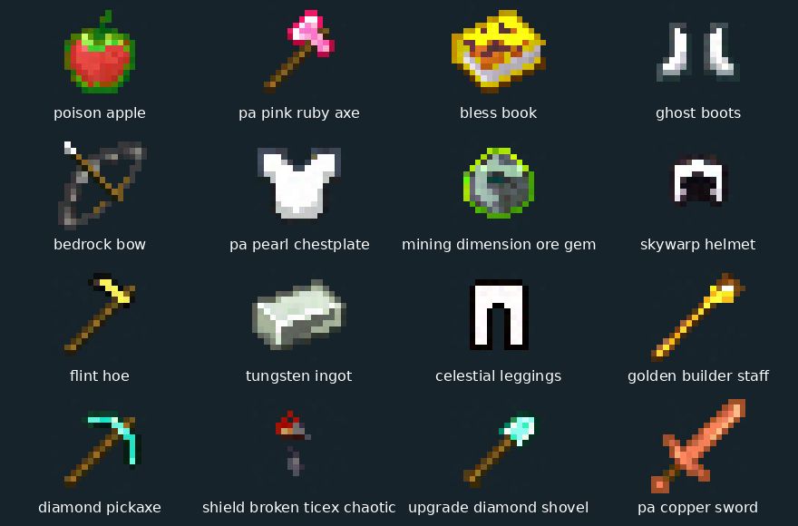
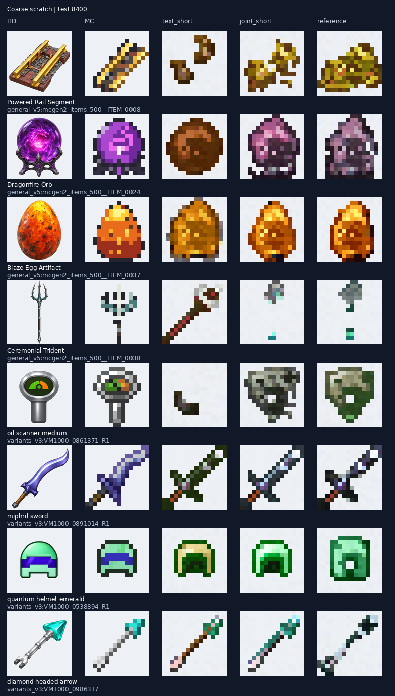

# MC Gen 2.0

用英文物品名、高清参考图，或两者一起，生成 **16×16 RGBA Minecraft 风格物品图**。当前推荐权重为 **coarse-step8400**。提示词可以从 `poison apple`、`ghost boots`、`diamond sword` 这样的短名称开始。

## 生成效果



上图取自广域验证抽样的前 16 个提示，全部使用同一种子。下图来自高清配对测试集，每行从左到右为高清参考、MC 目标、纯文字、文字加参考、纯参考。



在 263 个配对测试目标上，图文联合的轮廓 IoU 为 **0.661**，纯参考图为 **0.639**，纯文字为 **0.556**。短名称往往对应多种合理外观，这组数字衡量与配对目标的接近程度。

## 快速使用

在项目根目录安装依赖并下载生成器及冻结编码器。

```bash
pip install -e '.[embedding]'
curl -fL --create-dirs -o checkpoints/mcgen-coarse-step8400.pt \
  https://huggingface.co/datasets/Risposta/MC_Gen/resolve/main/checkpoints/coarse-step8400/mcgen-coarse-step8400.pt
python scripts/download_qwen_vl_embedding.py --out ../Qwen3-VL-Embedding-8B
export MCGEN_EMBEDDING_MODEL=../Qwen3-VL-Embedding-8B
mcgen sample --checkpoint checkpoints/mcgen-coarse-step8400.pt \
  --prompt 'diamond sword' --steps 32 --text-scale 2 --seed 42 \
  --device cuda:0 --out outputs/sword.png
```

图文联合生成时添加 `--reference item.png --conditioning-mode visual_tokens`。纯参考图生成时省略 `--prompt`。参考图测试采用 `--text-scale 1 --ref-scale 1`。

[权重及校验文件](https://huggingface.co/datasets/Risposta/MC_Gen/tree/main/checkpoints/coarse-step8400) · [冻结编码器](https://huggingface.co/Qwen/Qwen3-VL-Embedding-8B)

## 训练数据

从零训练生成器，使用 284,825 条广域文件名标签，以及 3,586 个高清与 MC 配对训练目标。配对中 2,472 个使用来源文件名提取的标签，其余 1,114 个使用数据包中的简短物品名。先训练文生图，再从第 5,500 步底座学习高清参考条件，最后混合训练三种生成模式。

[配对数据与来源](docs/data-releases.md) · [数据处理样本](examples/data_review/README.md) · [训练数据仓库](https://huggingface.co/datasets/Risposta/MC_Gen)

如有素材权利问题，可联系维护者申请移除相关权重。
