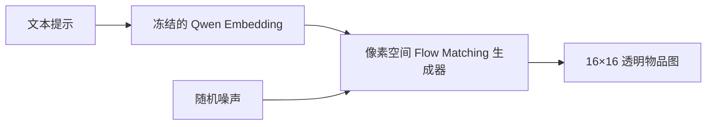

<div align="center">

# MCGen

**从一句话，生成 Minecraft 风格的像素物品。**

Text-to-Image · 16×16 RGBA · 81.4M Generator

[生成方式](#生成方式) · [数据与规模](#数据与规模) · [开始使用](#开始使用) · [数据处理抽样](examples/data_review/README.md)

</div>


<p align="center"><sub>选用第 4128 步检查点。16 个精选提示词使用同一固定种子，原生像素仅做最近邻放大。<a href="docs/images/showcase/manifest.json">提示词与来源</a></sub></p>

从 `diamond sword` 到 `sun gem`，尝试物品、材质、颜色和抽象名称的组合。当前专注文生图，参考图路线暂缓；复杂部件关系和少见物品仍有错误。

## 生成方式



生成器从零训练，直接在 Minecraft 物品纹理上学习文字与像素的对应关系。文本条件来自 **Qwen3-VL-Embedding-8B** 的官方归一化向量；本阶段只输入文本。

## 数据与规模

| 项目 | 当前版本 |
| --- | --- |
| 输出 | 16×16，RGBA 透明背景 |
| 生成器 | **81,409,028 参数（约 81.4M）**，512 宽、12 层 Transformer |
| 文本编码器 | **Qwen3-VL-Embedding-8B**，冻结；不计入生成器参数量 |
| 训练集 | **311,510 张** |
| 验证集 | **40,808 张** |
| 当前选用 | **第 4128 步**，依据生成效果选择 |

纹理主要来自 [OVAWARE/16xModdedMinecraft](https://huggingface.co/datasets/OVAWARE/16xModdedMinecraft) 及其图文衍生数据，覆盖多种 Minecraft 模组。项目整理的数据导出位于 [Risposta/MC_Gen](https://huggingface.co/datasets/Risposta/MC_Gen)，可通过[下载脚本](scripts/download_dataset_hf.py)获取。

源表包含 1,034,057 条纹理记录；上表是经过去重、原生像素校验和清理后的实际使用量。文本监督由文件名和可恢复的资源路径提取，保留材质、颜色和抽象名称，不使用自动视觉描述。按来源项目划分数据，隔离跨集合重复。

本轮训练已结束，后期检查点出现退化，当前保留 4128 步。[查看训练与检查点对照](docs/EMBEDDING_TEXT_20261103.md)。

## 开始使用

```bash
pip install -e '.[embedding]'

# 需先准备对应的生成器检查点与 Qwen Embedding 模型
mcgen sample --checkpoint checkpoints/mcgen-step4128.pt \
  --prompt 'diamond sword' --seed 20261112 \
  --steps 32 --text-scale 2 --out outputs/diamond_sword.png --device cuda:0
```

当前仓库提供代码、展示原图与少量可核验的数据样本；生成器权重、完整数据和特征缓存不随 Git 提交发布。

[安装、模型准备与更多命令](docs/USAGE.md) · [文本与数据处理](docs/RESOURCE_TEXT_20261103.md) · [项目进度](PROGRESS.md)

## License

Research and study only. Do not use the trained models commercially.
