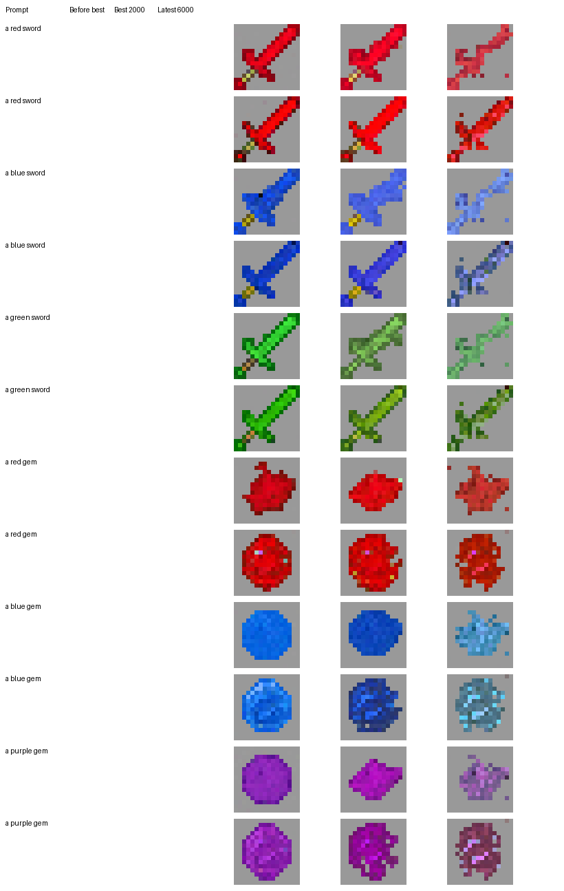

# MCGen v3

原生 16×16 Minecraft / Mod 物品生成，使用冻结的 **Qwen3-8B** 和 pixel-space flow。新版代码位于 `src/mcgen/`；旧版实现保留作历史参考。

**当前优先做好文生图，高清参考图路线暂停。** 架构保留文本、参考图及联合条件接口，但不代表所有入口都已达到相同质量。

## 当前候选与实验状态

截至 2026-11-03，全量训练 **best（第 2,000 步）** 经使用者查看后被认可为基本可用、观感优于此前候选，作为当前优先试用模型。它仍是实验候选，尚未发布权重或替换服务默认配置。

- 清理后训练图 **324,921** 张、验证图 **41,869** 张，保持原有项目与内容划分，测试集未用于此次实验。
- 其中 **10,000 张训练图**有自动描述；这些图按文件名／描述各 50% 采样，其余只用文件名。描述异常时保留图片和文件名监督。
- 计划 200,000 步，按使用者设定于 11 月 3 日 09:00 停止，实际完成 **6,000 步**。最后一步生成明显退化，优先保留 **2,000 步 best**。
- 355 组固定提示／种子完成三方对照。best 基本保留原有类别能力；长尾指标仍有取舍，像素距离不能代替 MC 风格、完整性和语义符合度的人工判断。
- 当前训练和自动队列均已停止。仓库包含代码、配置、汇总指标与少量生成示例，**不包含训练图片、逐图标注、模型权重或特征缓存**。

完整数据配比、检查点标识、评估与复现范围见 [全量文生图实验](docs/TEXT_FULLSCALE_20261103.md)。



## 文档导航

- [v3 架构与数据契约](docs/ARCHITECTURE_V3.md)
- [双文本监督扩容](docs/TEXT_EXPANSION_20261102.md) / [上一轮长训](docs/TEXT_EXTENSION_20261102.md)
- [标注审计](docs/TEXT_CAPTION_AUDIT.md) / [文本学习能力诊断](docs/TEXT_LEARNABILITY_20261102.md)
- [v2 重构记录](docs/REBUILD_V2.md) / [历史 README](docs/LEGACY_README_20261009.md) / [完整进度](PROGRESS.md)

## 安装与验证

```bash
pip install -e '.[test]'
mcgen smoke --out outputs/my_smoke
python -m pytest -q
```

本机解释器 `/home/iflab/miniconda3/envs/mcgen/bin/python`。
不安装时使用 `PYTHONPATH=src python -m mcgen ...`。
Qwen 已下载至 `/home/iflab/models/Qwen3-8B`，固定官方 commit
`b968826d9c46dd6066d109eabc6255188de91218`，权重哈希已核验。

## 数据准备

本机可直接使用 `data/catalogs/native16_v3/catalog`。它由完整旧数据重新划分，隔离跨集合重复，并将目标无损压缩成原生 16px；旧数据未改动。

```bash
# 重新从旧项目迁移时，使用新目录
mcgen migrate --project . --out data/catalogs/new_source --size 16 --include-text
mcgen prepare --catalog data/catalogs/new_source --out data/catalogs/new_prepared
mcgen audit --catalog data/catalogs/new_prepared/catalog
```

`prepare` 输出固定项目划分、隔离清单、原生 mmap、alpha 检测和审计报告。
可用 `--project-plan plan.json` 指定已审查的项目归属。新素材以 PNG JSONL 导入：

```bash
mcgen import-images --manifest samples.jsonl --out data/new_assets --size 16
```

每行包含 `id,lineage,prompt,asset_type,tileable,target`，可选 `reference,license,style`。
图片路径相对于 manifest。asset_type 为 item/tile/other；tileable 为 true/false/null。
多来源先 `mcgen merge --catalog ... --out ...`，再统一 prepare，不能拼接独立划分。

## 预算与训练

`configs/v3/` 包含 item/tile 各自的 text/reference/joint 六组短试验配置；`other` 不进入这些实验。
默认三种任务使用同一批配对目标，保证对照的数据范围一致；全量文生图扩展配置位于 `configs/v3/scale/`。
保留 Qwen 三层特征，独立文字/参考图注意力，显式任务比例和有容量上限的特征缓存。

```bash
mcgen budget --config configs/v3/item_joint.yaml \
  --catalog data/catalogs/native16_v3/catalog --out outputs/item_budget.json

mcgen train --config configs/v3/item_joint.yaml \
  --catalog data/catalogs/native16_v3/catalog --out outputs/item_joint \
  --device cuda:0 --text-device cuda:1
```

先查看预算中的任务曝光；默认 2,000 步是试验，不代表百万数据训练充分。
断点续训在同一命令上加 `--resume outputs/item_joint/latest.pt`，配置、数据指纹和文本塔身份必须一致。
训练保存 latest、分任务 best flow、预算和指标。flow 最优不代表生成质量最优。
`configs/v3/ablations/` 提供注意力共享、Qwen 层和宽度对照配置。

## 生成与服务

```bash
mcgen sample --checkpoint outputs/item_joint/latest.pt \
  --prompt 'red crystal sword' --out outputs/sword.png --device cuda:0 --text-device cuda:1
mcgen sample --checkpoint outputs/item_joint/latest.pt \
  --reference reference.png --prompt 'red crystal sword' \
  --out outputs/sword_ref.png --device cuda:0 --text-device cuda:1
mcgen serve --checkpoint outputs/item_joint/latest.pt --device cuda:0 --text-device cuda:1
```

省略 prompt 可做纯参考图生成。text 专用模型拒绝参考图；reference 专用模型必须有参考图。
`--export-scale 2` 为最近邻显示放大，`--palette-colors 16` 为显式后处理。原始评测不应用这些修饰。
参考图保留透明度和长宽比；checkpoint 的 alpha 输出契约应用于 CLI/API 导出。
API 提供 `/health`、`POST /generate`，请求支持 prompt、reference_png（base64 PNG）、seed、steps、text_scale、ref_scale、solver、export_scale、palette_colors。默认监听 127.0.0.1。

## 配对评测与语义盲评

```bash
mcgen evaluate --checkpoint outputs/item_joint/latest.pt \
  --catalog data/catalogs/native16_v3/catalog --split test --n 64 \
  --out outputs/item_test --device cuda:0 --text-device cuda:1

mcgen benchmark --checkpoint outputs/item_joint/latest.pt \
  --manifest benchmarks/semantic_v1.jsonl --out outputs/item_semantics \
  --device cuda:0 --text-device cuda:1
mcgen review --directory outputs/item_semantics
```

evaluate 使用同目标、同种子的条件对照和 resize/palette 基线，并按素材类型、生成器汇总。
评估独立外部 catalog 时须加 `--training-catalog` 指向训练时 catalog，自动核查已知重叠。

benchmark 固定任务标准、多个种子，导出盲评 CSV。参考图案例须提供 reference、reference_sha256 和 provenance。
隐藏 `key.json` 完成人工评分后运行 review；未填的评分始终显示待评，不自动冒充质量通过。
