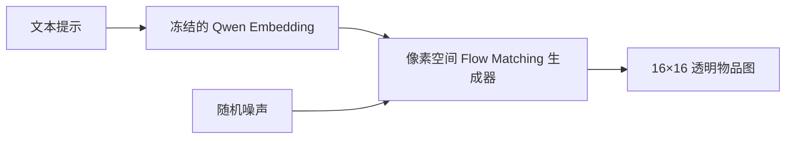

<div align="center">

# MC Gen


Text-to-Image · 16×16 RGBA · 81.4M Generator

[生成方式](#生成方式) · [数据与规模](#数据与规模) · [开始使用](#开始使用) · [数据处理抽样](examples/data_review/README.md)

</div>


[PDF 原图](docs/images/showcase/showcase.pdf) · [样本与提示词](docs/images/showcase/manifest.json)


使用原始文件名提取文本标注生成，计划未来实现参考图生成。

相比MC_Gen上一版，使用了Flow Matching进行训练，并把文本编码器换成了Qwen的8B文本编码模型。并且用了更多数据。
尝试使用VLM精标注，但是很难得到不错的标注，所以还是恢复了文件名提取文本标注。提示词尽量使用形容词+名词的形式。
原因主要猜测还是对于MC素材这种低像素风格目前的VLM能力不强，所以没法从低分辨率信息得到精确描述。
训练数据已上传huggingface：https://huggingface.co/datasets/Risposta/MC_Gen
之前使用flux和qwen_image生成了一些高清图片-MC素材的图片对，计划后续阶段用来进行获取参考图的能力，从而利用现在的其他高清文生图模型来制造高质量文本与MC素材的数据对，再用于提高文生图的能力。
展示图使用GPT 6.1sol制作（GPT审美还是太差了）

## 生成方式



从零训练，直接在 Minecraft 物品纹理上学习文字与像素的对应关系。

## 数据与规模

| 项目 | 当前版本 |
| --- | --- |
| 输出 | 16×16，RGBA 透明背景 |
| 生成器 | **81,409,028 参数（约 81.4M）**，512 宽、12 层 Transformer |
| 文本编码器 | **Qwen3-VL-Embedding-8B**，冻结；不计入生成器参数量 |
| 训练集 | **311,510 张** |
| 验证集 | **40,808 张** |

纹理主要来自 [OVAWARE/16xModdedMinecraft](https://huggingface.co/datasets/OVAWARE/16xModdedMinecraft) 及其图文衍生数据，覆盖多种 Minecraft 模组。项目整理的数据导出位于 [Risposta/MC_Gen](https://huggingface.co/datasets/Risposta/MC_Gen)，可通过[下载脚本](scripts/download_dataset_hf.py)获取。

源表包含 1,034,057 条纹理记录；上表是经过去重、原生像素校验和清理后的实际使用量。文本监督由文件名和可恢复的资源路径提取，保留材质、颜色和抽象名称。按来源项目划分数据，隔离跨集合重复。


## 开始使用

```bash
pip install -e '.[embedding]'

# 需先准备对应的生成器检查点与 Qwen Embedding 模型
mcgen sample --checkpoint checkpoints/mcgen-step4128.pt \
  --prompt 'diamond sword' --seed 20261112 \
  --steps 32 --text-scale 2 --out outputs/diamond_sword.png --device cuda:0
```

当前仓库提供代码、展示原图与少量可核验的数据样本；生成器权重、完整数据和特征缓存不随 Git 提交发布。

[安装、模型准备与更多命令](docs/USAGE.md) · [文本与数据处理](docs/RESOURCE_TEXT_20261103.md) · [项目进度](PROGRESS.md)

## License

Research and study only. Do not use the trained models commercially.
