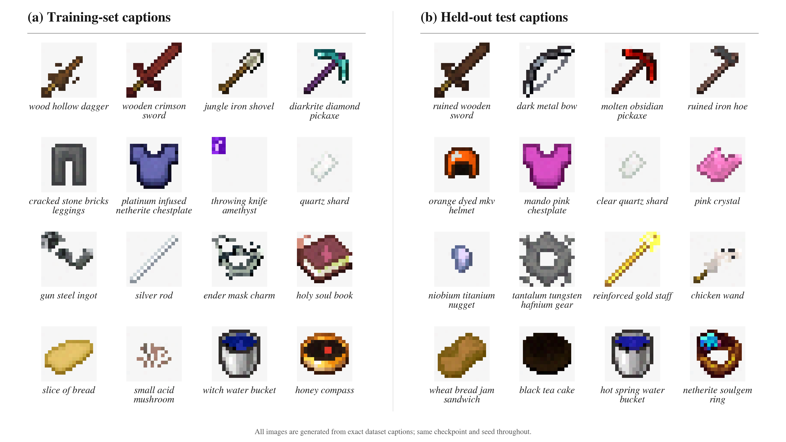
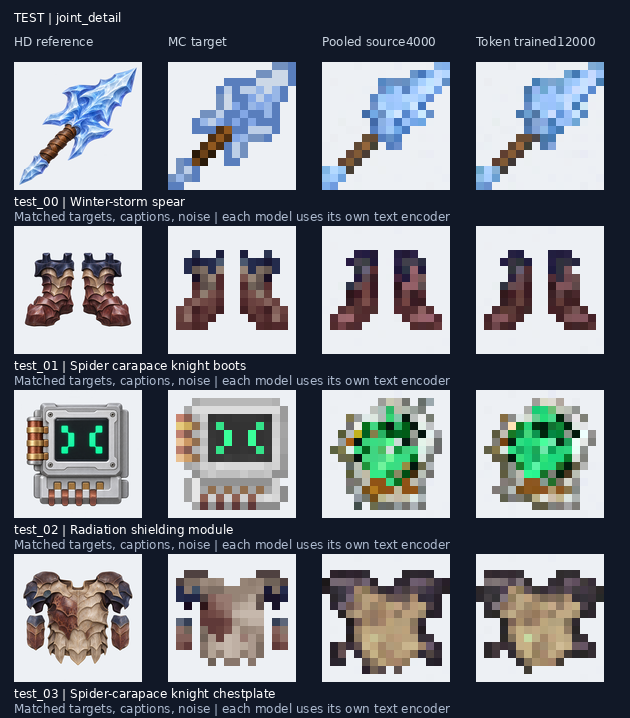
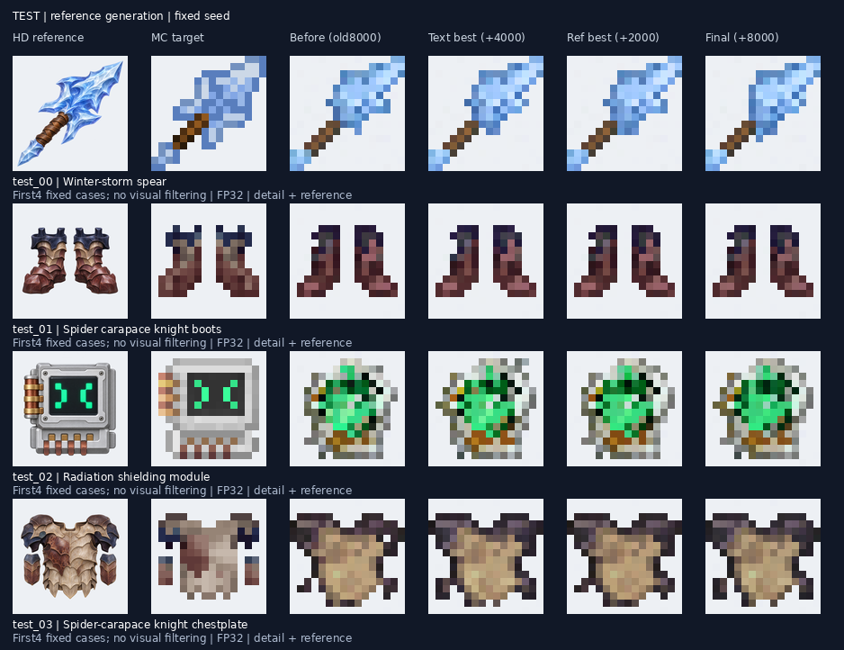
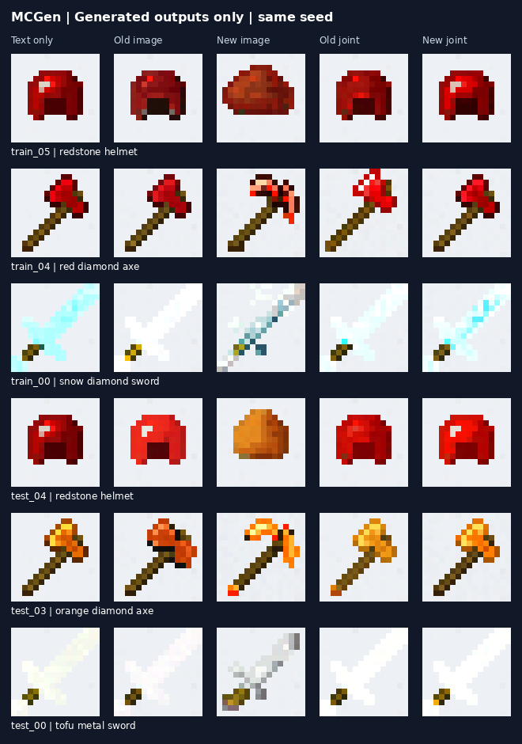
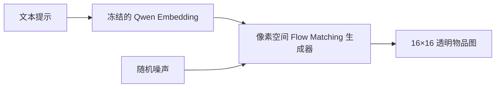

<div align="center">

# MC Gen


Text-to-Image · Reference-to-Image (experimental) · 16×16 RGBA

[近期结果](#近期参考图结果) · [参考图效果](#参考图生成实验) · [生成方式](#生成方式) · [数据与规模](#数据与规模) · [开始使用](#开始使用) · [数据处理抽样](examples/data_review/README.md)

</div>



[PDF 原图](docs/images/showcase/showcase.pdf) · [样本与提示词](docs/images/showcase/manifest.json)


使用原始文件名提取文本标注生成。现提供参考图生成实验版，支持纯参考图和图文联合输入。

相比MC_Gen上一版，使用了Flow Matching进行训练，并把编码器换成了Qwen3-VL-Embedding-8B。并且用了更多数据。
尝试使用VLM精标注，但是很难得到不错的标注，所以还是恢复了文件名提取文本标注。提示词尽量使用形容词+名词的形式。
原因主要猜测还是对于MC素材这种低像素风格目前的VLM能力不强，所以没法从低分辨率信息得到精确描述。
训练数据已上传huggingface：https://huggingface.co/datasets/Risposta/MC_Gen

[参考图配对数据与标注](https://huggingface.co/datasets/Risposta/MC_Gen/tree/main/data/reference-20261107)：高质量主数据与无损16×16训练版本，附真实数据预览。
参考图实验使用flux和qwen_image生成的高清图片-MC素材配对。早期冻结底座训练适配器，近期加入粗标/精标五任务训练与时间MLP冻结续训。
展示图使用GPT 6.1sol制作（GPT审美还是太差了）

如果觉得存在侵犯知识版权的问题可以联系我删除checkpoint

## 近期参考图结果

**多 token 文本条件 · 全量训练 12,000 步**



依次为参考图、MC目标、旧版、新版。固定取前4个测试目标，保留失败结果。

高质量配对上的文生图有所改善，但广域文生图退化，参考图泛化基本持平；本轮作为独立实验保留，原发布版本不变。

[文生图对照与评估](docs/TOKEN_TEXT_EVALUATION_20261109.md) · [少量原图、标签与生成结果](examples/token_text_20261109/README.md) · [实验权重与用法](docs/USAGE.md#多-token-文本实验12000步)

**2000张多类型文生图回放实验**



依次为参考图、MC目标、训练前、文字最佳4000步、参考最佳2000步、最终8000步。固定抽样，保留失败结果。

文生图有小幅恢复，参考图泛化和联合文字控制尚未明显改善。已完成训练内外5504张原生输出对照。

[文生图对照与完整评估](docs/REFERENCE_TEXT_REPLAY_EVALUATION_20261108.md) · [少量回放数据与原标签](examples/text_replay_2000/README.md)

公开参考图权重为上一轮 **8,000步文字最佳版本（未冻结时间MLP）**：[下载权重](https://huggingface.co/datasets/Risposta/MC_Gen/resolve/c14c8a4f1b869d5b57bcff9ebe2c18cd745a97a2/checkpoints/reference-five-task-text-step8000/mcgen-reference-five-task-text-step8000.pt) · [校验文件](https://huggingface.co/datasets/Risposta/MC_Gen/resolve/c14c8a4f1b869d5b57bcff9ebe2c18cd745a97a2/checkpoints/reference-five-task-text-step8000/SHA256SUMS.txt) · [使用说明](docs/USAGE.md#five-task-reference-8000)。

<details>
<summary>上一轮：时间MLP冻结对照</summary>


对比上一轮 **8,000步**与冻结时间MLP后续训4,000步的 **12,000步**结果。依次为高清参考、MC原图、两版文生图、两版图文生成。固定取4个验证、2个训练目标，保留失败结果。

常见物品能够成形，复杂轮廓与装饰仍不稳定。后期失稳的16,000步版本未采用，较早权重完整保留。

[样本、文本与来源](examples/time_freeze_reference/README.md) · [训练方案](docs/FIVE_TASK_REFERENCE_20261108.md) · [稳定性诊断](docs/FIVE_TASK_INSTABILITY_20261108.md)

</details>

## 参考图生成（实验）


每组依次为：**参考图、MC 原图、纯文本、纯参考图、图文联合**。固定抽样，保留失败结果。

已完成训练内、训练未见各64个新物品的双种子对照，共896张输出。常见物品能成形，浅色过亮、色偏和复杂造型不稳仍明显。原有文生图输出保持一致。

[参考图权重与用法](docs/USAGE.md#参考图生成实验) · [样本与来源](examples/reference_generation/README.md) · [完整对照下载](https://huggingface.co/datasets/Risposta/MC_Gen/tree/main/evaluations/reference-step2151)

**独立视觉 token 实验：新旧方案对照**



依次为：纯文本、旧版纯图、新版纯图、旧版图文、新版图文。这里只展示生成结果。

新版图文联合更接近配对 MC 原图，纯参考图弱于旧版；装饰多样性尚未稳定改善。两版训练预算不同，旧版继续保留。

[实验权重与用法](docs/USAGE.md#空间参考图实验) · [评估结论](docs/SPATIAL_REFERENCE_EVALUATION_20261104.md)

## 生成方式



从零训练，直接在 Minecraft 物品纹理上学习文字与像素的对应关系。

## 数据与规模

| 项目 | 文生图基础模型 |
| --- | --- |
| 输出 | 16×16，RGBA 透明背景 |
| 生成器 | **81,409,028 参数（约 81.4M）**，512 宽、12 层 Transformer |
| 文本编码器 | **Qwen3-VL-Embedding-8B**，冻结；不计入生成器参数量 |
| 训练集 | **311,510 张** |
| 验证集 | **40,808 张** |

纹理主要来自 [OVAWARE/16xModdedMinecraft](https://huggingface.co/datasets/OVAWARE/16xModdedMinecraft) 及其图文衍生数据，覆盖多种 Minecraft 模组。项目整理的数据导出位于 [Risposta/MC_Gen](https://huggingface.co/datasets/Risposta/MC_Gen)，可通过[下载脚本](scripts/download_dataset_hf.py)获取。

源表包含 1,034,057 条纹理记录；上表是经过去重、原生像素校验和清理后的实际使用量。文本监督由文件名和可恢复的资源路径提取，保留材质、颜色和抽象名称。按来源项目划分数据，隔离跨集合重复。


## 开始使用

[下载文生图权重](https://huggingface.co/datasets/Risposta/MC_Gen/resolve/85470a51e497cea27ceb4d639e822440f660ac1a/checkpoints/step4128/mcgen-step4128.pt)（约 326 MB） · [SHA256 校验](https://huggingface.co/datasets/Risposta/MC_Gen/resolve/85470a51e497cea27ceb4d639e822440f660ac1a/checkpoints/step4128/SHA256SUMS.txt)

Qwen3-VL-Embedding-8B 需单独下载，脚本会固定版本并校验文件。

```bash
pip install -e '.[embedding]'

curl -L --fail --create-dirs -o checkpoints/mcgen-step4128.pt \
  https://huggingface.co/datasets/Risposta/MC_Gen/resolve/85470a51e497cea27ceb4d639e822440f660ac1a/checkpoints/step4128/mcgen-step4128.pt
python scripts/download_qwen_vl_embedding.py --out ../Qwen3-VL-Embedding-8B
MCGEN_EMBEDDING_MODEL=../Qwen3-VL-Embedding-8B mcgen sample \
  --checkpoint checkpoints/mcgen-step4128.pt \
  --prompt 'diamond sword' --seed 20261112 \
  --steps 32 --text-scale 2 --out outputs/diamond_sword.png --device cuda:0
```

生成器权重通过 Hugging Face 分发；Git 仓库提供代码、展示原图与少量可核验的数据样本，完整数据和特征缓存不随 Git 提交。

[安装、模型准备与更多命令](docs/USAGE.md) · [文本与数据处理](docs/RESOURCE_TEXT_20261103.md) · [项目进度](PROGRESS.md)

[手工筛选训练配对](docs/PAIR_REVIEW.md)：本地网页对照MC原图与两版高清参考图，分别审核并选择是否用于训练，自动保存并导出训练清单。

## License

Research and study only. Do not use the trained models commercially.
