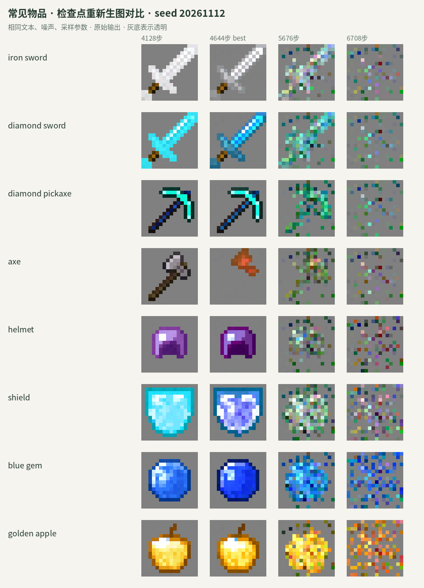
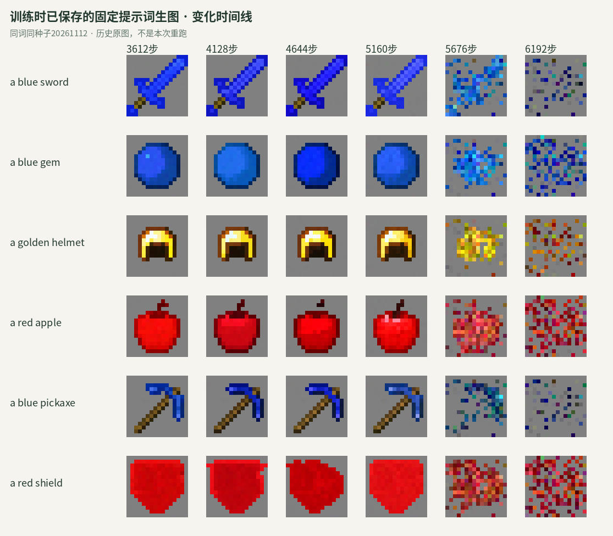

# 当前文生图版本

当前选用 **4128 步**，依据相同提示、种子的生成图人工比较确定。生成器约 81.4M 参数，冻结的 Qwen3-VL-Embedding-8B 提供文本条件；训练集 311,510 张，验证集 40,808 张。只使用文件信息文本，不使用视觉描述。

本轮已完成 7,211 步，队列在用户要求停止前已经结束。后期发生明显退化：5160 步历史固定提示尚有完整轮廓，5676 步开始大量破碎，6708 步进一步损坏。平均训练损失在约 5250～5350 步快速上升；触发原因尚未确定。

| 检查点 | 固定验证 Flow MSE | 使用决定 |
| --- | --- | --- |
| 4128 | 0.1502 | 用户选择，当前推荐 |
| 4644 | 0.1487 | 自动误差最小，保留作对照 |
| 5676 | 0.4375 | 生成退化 |
| 7211 | 0.6839 | 最终保存，生成退化 |

本次重跑 4128 / 4644 / 5676 / 6708，24 条提示、每条两个固定种子，共 192 张。8 条常见物品、4 条概念名称及此前已经查看的验证集、测试集各 6 条。所有检查点使用同一 CPU、FP32、32 步 Heun、CFG 2。手工提示不声称为训练中未出现的文本；这是定性对照，不是独立泛化评分。

更早权重没有逐个归档，下面复用训练时保存的固定提示、种子原图：

本机推理文件：`checkpoints/mcgen-step4128.pt`。导出仅移除优化器，全部生成器张量、配置和文本身份与原始 4128 快照逐项一致。权重已通过 [Hugging Face](https://huggingface.co/datasets/Risposta/MC_Gen/tree/85470a51e497cea27ceb4d639e822440f660ac1a/checkpoints/step4128) 发布，Git 仓库不存放大权重。[选版和哈希](models/step4128.json) · [验证记录](models/validation_metrics.json) · [训练损失变化](models/training_loss_transition.json)。

README 当前展示采用训练集、测试集各 16 条真实标签和统一种子，全部来自该检查点的原始输出。[展示清单](images/showcase/manifest.json)可核验图片哈希；绘图仅放大和排版。
