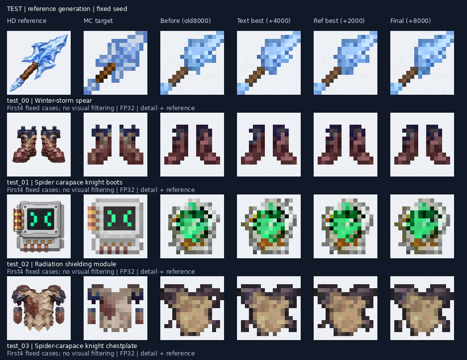
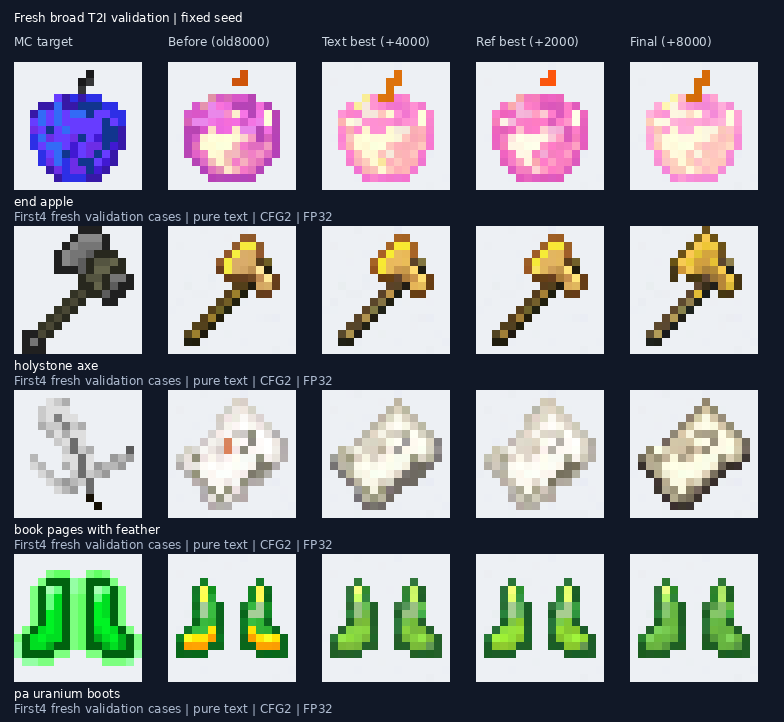
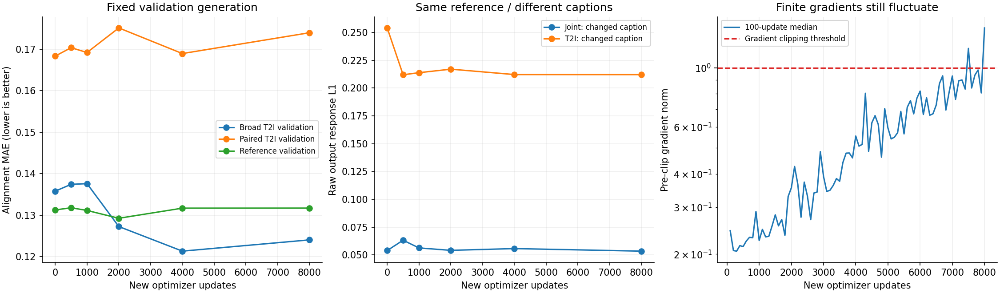

# 2000张文生图回放：训练结束评估

本轮完成新增8000次更新，时间MLP冻结。**回放明显改善了所抽取训练目标的文生图拟合，但新广域验证只小幅改善；参考图泛化和联合文字响应基本持平。** 没有出现上一轮的整体崩坏，后段仍有梯度波动。

比较训练前、文字最佳（本轮4000步）、参考最佳（本轮2000步）、最终（本轮8000步）。综合最佳实际停在训练起点，因此不把它冒充新版本。

## 范围

- 参考任务：全部56个测试目标、32个额外验证目标、24个训练目标，五种任务、两个固定种子。
- 纯文生图：48个新广域验证目标，排除训练期间监控的1024个验证目标；48个回放训练目标，每个文字分组抽一个，均为双种子。
- 原始4128步文生图底座作为额外纯文字对照。

共整理5504张原生16×16 RGBA输出。统一FP32、32步Heun；参考任务CFG1，纯文字CFG2。展示仅最近邻放大，不改变生成分辨率。固定顺序，不筛除失败样本；训练前与最终版的已完成结果按检查点哈希复用。

这里“未见”指本轮参考微调和本轮验证监控的留出范围，不宣称基础预训练完全未见。没有用测试结果重选或替换发布权重。

## 结果

误差为预乘alpha像素对齐MAE，越低越好；轮廓IoU越高越好。尤其纯文生图可能存在多个合理目标，这些不是语义或编辑正确率。

| 版本 | 新广域T2I误差 | 新广域T2I轮廓IoU | 参考测试图文误差 | 参考测试图文轮廓IoU |
|---|---:|---:|---:|---:|
| 原文生图4128 | 0.1267 | 0.8036 | — | — |
| 训练前 | 0.1318 | 0.7709 | 0.1172 | 0.6775 |
| 文字最佳 +4000 | 0.1293 | 0.7947 | 0.1178 | 0.6754 |
| 参考最佳 +2000 | 0.1299 | 0.7924 | 0.1164 | 0.6774 |
| 最终 +8000 | 0.1323 | 0.7889 | 0.1165 | 0.6770 |

4000步的新广域文字误差比训练前降低约1.9%，尚未超过原始文生图底座。训练时监控的24张广域验证曾改善约10.6%，新的48张没有复现同样幅度，不能混用两组数字。

回放训练目标的T2I误差从0.1604降至最终0.1316，约下降17.9%。参考训练目标的图文轮廓IoU从0.9946升至0.9973，而参考测试约0.678基本不变。收益主要集中在训练目标，不能据此宣称未见设计能力明显提高。

图中方形辐射模块在各版仍生成圆形外观，是保留的失败样本。

## 文字控制与稳定性

同一参考、同一噪声下更换已有完整描述，训练监控的联合输出响应L1从0.0540到最终0.0534，基本持平。在全部参考测试中，联合与纯图输出差异约0.0325，各版同样接近。这只能诊断响应幅度，不代表指令编辑是否正确；没有冲突编辑真值。

四种参考权重的时间MLP与初始化逐元素一致，原始检查点哈希未变。最后1000步约46.4%更新触发梯度裁剪，最大裁剪前梯度476；持续失稳保护没有触发。冻结时间MLP避免了本轮重现上一轮整体崩坏，但不能将优化稳定性视为已经彻底解决。

这次支持的判断是：广域回放有助于补回部分纯文生图能力，**没有解决联合条件下文字缺乏必要性的问题**。进一步单纯延长同类重建训练缺少收益证据；后续应单独验证有明确目标变化的文字控制监督。

## 查看与复核

[完整查看入口](http://localhost:8766/replay-evaluation/) 沿用此前SSH端口转发。训练集、额外验证、测试集和广域任务分别展示，保留两个种子及失败结果。

[随仓库保留的汇总数据与权重哈希](models/text_replay_20261108.json) · [12张回放训练图及原标签](../examples/text_replay_2000/README.md)。本机网页入口依赖原实验输出，完整生成结果未随Git提交。

本地目录：`outputs/reference_text_replay2000_review_20261108/`。

- `protocol.json`：四种权重的步数、哈希与采样协议。
- `metrics.json`：逐输出误差及分组统计。
- `review_summary.json`：条件响应、冻结检查、原始底座对照与训练健康度。
- `verification.json`：5312张四版本输出的维度与源检查点哈希检查；额外192张原始底座结果在`foundation4128/`。`native_manifest.json`记录全部5504张输出的SHA256。
- `panels/`：全部对照图、文字响应和训练诊断。

复跑入口：`scripts/evaluate_text_replay.py`；补充原始底座与诊断：`scripts/summarize_text_replay_evaluation.py`。运行不更新模型权重。
