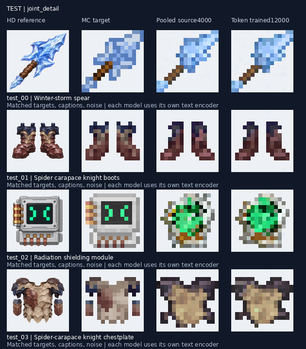
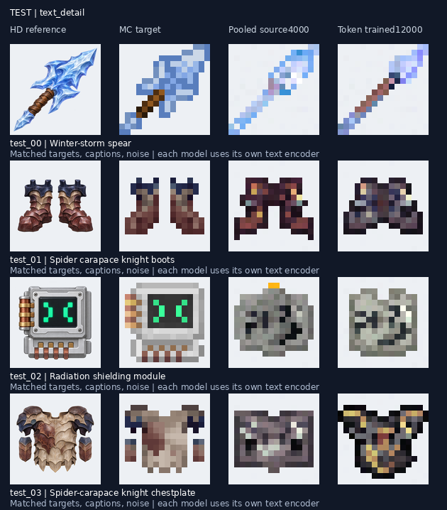
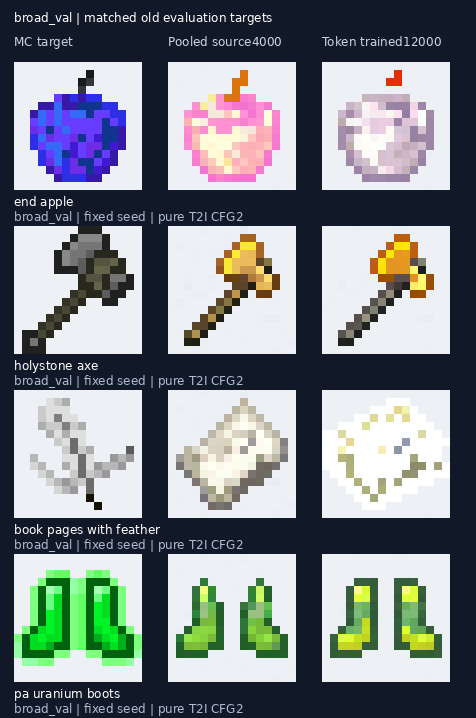

# 多 token 文本条件：全量训练评估

2026-11-09。12,000 步训练、自动评估与跨编码协议对照均完成。

结论：高质量配对上的纯文生图改善，但广域样本没有同步改善；参考图训练集拟合进一步提高，未见设计泛化基本持平。尚不适合替换已发布模型。

依次为高清参考、MC目标、旧汇总向量模型、新多token模型。

本图高清参考仅用于展示输入设计；两版生成均只输入文字。

依次为MC目标、旧版、新版；全部图均固定顺序抽样，保留失败结果。[少量原图、实际标签与生成文件](../examples/token_text_20261109/README.md)

## 对比口径

- 旧版：本轮实际初始化来源，广域回放训练的文字最佳第 4,000 步，使用原汇总向量编码协议。
- 新版：多 token 全量训练第 12,000 步，也是本轮文字与综合指标最佳；最终权重与综合最佳逐张量一致。
- 两版使用相同目标、提示、参考图、两个随机种子、32 步 Heun 和 FP32。参考任务 CFG=1，广域纯文字 CFG=2。
- 参考评估覆盖全部 56 个测试目标、32 个额外验证目标、24 个训练目标，均生成五种条件。补充对比沿用上一轮的 48 个广域验证和 48 个回放训练目标。
- 新协议第 0 步只是迁移后的初始化，不代表旧版的正常推理行为。本报告使用各自正确协议比较。

## 结果

误差为预乘 RGBA MAE，越低越好；IoU 为 alpha 轮廓交并比，越高越好。

| 样本与条件 | 旧版误差 | 新版误差 | 旧版 IoU | 新版 IoU |
|---|---:|---:|---:|---:|
| 参考测试：粗标纯文字 | 0.1764 | 0.1670 | 0.5077 | 0.5568 |
| 参考测试：精标纯文字 | 0.1548 | 0.1504 | 0.5725 | 0.6113 |
| 参考测试：精标与参考图 | 0.1178 | 0.1180 | 0.6754 | 0.6744 |
| 参考测试：纯参考图 | 0.1209 | 0.1202 | 0.6649 | 0.6650 |
| 参考训练：精标与参考图 | 0.0197 | 0.0169 | 0.9961 | 0.9983 |
| 广域验证：纯文字 | 0.1293 | 0.1350 | 0.7947 | 0.7927 |
| 原回放训练抽样：纯文字 | 0.1402 | 0.1677 | 0.6739 | 0.5749 |

高质量配对测试的粗标与精标纯文字误差分别下降约 5.4% 和 2.9%。广域验证误差上升约 4.4%，原回放训练抽样上升约 19.6%。原回放样本属于本轮全量训练池；48 个目标的结果不能代表全部 297,412 张训练数据。

参考联合生成的训练与测试差距仍大。查看对照图，测试中的辐射模块仍容易生成宝石形状，特殊陷阱与装饰没有稳定恢复；训练目标则能接近复现。文字修改参考设计的能力仍没有明确改善证据：监控中的联合文字响应由旧版 0.0557 到新版 0.0470，该数值只衡量响应大小，不等于编辑正确率。

这轮同时改变了文本表示、训练数据范围、高质量权重和训练预算，因此不能把变化单独归因于多 token 架构。文件名弱标签也没有提供所有目标颜色、部件和设计信息，纯文字逐像素误差不能替代语义质量人工检查。

## 训练与产物

训练约 4.5 小时，完整完成 12,000 次更新，未发生上一轮末期的整体崩坏。但最后 1,000 步裁剪前梯度中位数约 1.58、裁剪比例约 67.4%，全程最大裁剪前梯度约 1611；不能宣称失稳问题已彻底解决。未改动发布权重。

12,000步推理权重已单独归档至[Hugging Face](https://huggingface.co/datasets/Risposta/MC_Gen/tree/0e1a7dcbf38a1a63f311268e49424c6a7cbd3b2f/checkpoints/token-full-hq-step12000)，与评估模型逐张量一致，不包含优化器或冻结编码器。[下载与推理](USAGE.md#多-token-文本实验12000步)

- 训练：`outputs/token_full_hq_20261109/`
- 自动评估：`outputs/token_full_hq_evaluation_20261109/`，3,408 张原生 16×16 RGBA 输出。
- 正确协议补充对比：`outputs/token_full_hq_protocol_review_20261109/`，新增 192 张广域输出，核对 112 个参考目标的身份、文字与参考图；源检查点哈希保持不变。
- 沿用 8766 SSH 转发后打开：[旧版与新版对照](http://localhost:8766/token-comparison/)；[本轮初始化、最佳与最终对照](http://localhost:8766/token-full-evaluation/)。入口及 PNG 已检查 HTTP 200。

下一步应先检查高质量采样权重与全量文字监督带来的分布取舍，并保留旧协议基线；不宜只凭配对集合的改善继续扩大训练预算。
