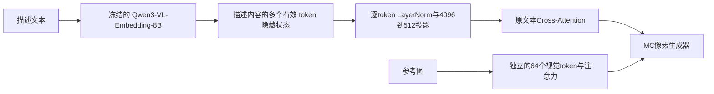

# 多token文本条件与全量训练

按本轮要求，文本路径改为：

使用同一份已验证的Qwen权重，自定义提取最后一层`last_hidden_state`，不再取最后一个汇总向量。描述字段保留统一的MC风格前缀，排除system、角色、特殊结束符和padding；有效token保持原顺序。空描述全部掩码，不会把模板内容当成条件。官方全局向量输出协议见[Qwen源码](https://github.com/QwenLM/Qwen3-VL-Embedding/blob/main/src/models/qwen3_vl_embedding.py)，本轮token协议与之明确区分。

旧检查点仍使用原单向量协议。新协议有独立身份，旧缓存不能混用；推理与离线缓存均使用单样本Qwen前向，并逐块检查二者一致性。原公开检查点未被替换。

## 数据与权重

使用全部清理后可用数据，继续保留原验证/测试隔离，排除之前剔除的有损32→16目标：

| 数据 | 数量/策略 |
|---|---|
| 文生图训练目标 | 297,412张，全部可抽取，不限于上一轮2000张 |
| 文生图验证目标 | 40,140张，训练不抽取 |
| 审核过的参考训练配对 | 1,064对、864个独立目标 |
| 高质量参考训练目标 | 372个，保留名称与已有精描述 |
| 配对内高质量抽样 | 60%提高到80%，源内先均匀抽目标再抽参考 |

原文生图目录有311,510个训练目标，去除参考目标重合及参考留出项目后剩297,412张。本轮使用这个可训练全集，不通过混入留出图片补足原数量。

每次更新为62对各五任务，加全量文生图回放：

| 任务 | 每次更新 |
|---|---:|
| 配对粗标/精标文生图 | 124 |
| 配对粗标/精标图文联合 | 124 |
| 纯参考图 | 62 |
| 全量广域文生图 | 288 |
| 无条件 | 42 |
| 总计 | 640 |

纯文字占64.375%。80%指配对目标来源的高质量比例，折合整个混合batch的期望高质量样本约40%，不是把全量数据的80%都叫作高质量。文字标签保持原样，没有重新自动标注。

## 缓存与预算

251,371条不同文本，共2,803,409个有效token，典型描述11个，最长98个。按实际长度保存BF16隐藏状态，约23GB；读batch时才padding，不为每条文本存512个位置。训练按文本长度分组微批量，padding不进入注意力。

从上一轮4000步文字最佳模型复制全部生成器权重，优化器重新建立。仅条件协议与序列长度改变；时间MLP继续冻结，Qwen和视觉编码器冻结，原视觉通路及64个视觉token保留。

- 正式预算：新增12,000次更新，有效batch640。
- 广域有条件文生图曝光：3,456,000次，平均约11.6次/可训练目标。
- 共享生成参数学习率`1e-6`；文本投影和文本注意力`1e-5`；视觉适配器`1e-5`。
- 微批量由缓存完成后的真实640样本混合更新测速选择，不预先认定显存越满越好。
- 在0/250/500/1000/2000/4000/8000/12000更新验证，保留文字、参考和综合最佳，启用持续失稳保护。

## 已执行的检查

262项回归测试通过。真实Qwen检查确认英文、中文、多token输出及空描述掩码正确，新缓存身份与实际模型一致。

8个真实高质量目标的描述有59–97个有效token，所有有效token均有非零输入梯度，padding梯度为零，纯文字没有视觉参数梯度。临时150次小样本更新后，两组固定新噪声误差由0.319/0.278降至0.031/0.033，冻结时间权重逐元素不变。

这个检查使用临时较高学习率，仅用于确认通路和可学习性；临时权重已丢弃，不用于正式训练，也不代表未见设计或编辑能力已经提高。

## 后台队列

本轮目录：`outputs/token_full_hq_20261109/`。

流水线已完成：双GPU缓存 → 通路检查 → 全量缓存校验 → 微批量测速 → 全量训练 → 训练内外评估。完成12,000次更新，选用微批量320、有效batch640；训练约4.5小时。文字与综合最佳均为12,000步，最终权重与综合最佳逐张量一致。[评估结果](TOKEN_TEXT_EVALUATION_20261109.md)

- `token_queue_status.json`：当前阶段、已缓存文本数与缓存剩余时间。
- `cache_cuda0.log`、`cache_cuda1.log`：逐块编码进度。
- `token_condition_check.json`：真实目标通路检查。
- `recipe.pending.json`：正式预算；完成缓存绑定后生成`recipe.json`。
- `code_archive/`：启动时源码哈希快照；阶段切换前检查代码是否变化。

训练后自动对比的是**新token协议的初始化0步**、综合最佳和最终权重。旧单向量模型不能直接喂入新token缓存；跨协议质量比较应分别使用各自正确编码的输出。此次同时改变了文本表征、数据范围和高质量抽样，不能把全部效果独立归因于其中一项。

本轮仍使用正确重建配对，没有加入“同图改文字后目标随之修改”的监督。因此，多token能力与联合文字必要性仍需分别用后续评估验证。

入口：`scripts/prepare_token_full_training.py`、`scripts/cache_token_text.py`、`scripts/check_token_conditioning.py`、`scripts/queue_token_full_training.py`。
