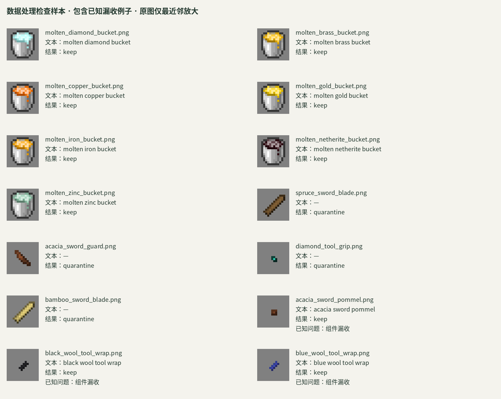

# 数据处理检查样本

这份小样本用于直接检查：图片是否对应原文件名、抽取文本是否保留语义、组件是否被正确隔离。



包含 **14 张原生 16×16 图片**：7 张当前保留的桶贴图、4 张已隔离的部件、3 张仍被漏收的组件。来自同一个已核验 MIT 许可的项目，按检查目的选取，**不代表全库比例或整体质量**。

- [samples.json](samples.json)：原图、文件信息、当前处理结果、来源与逐像素哈希。
- [text_cases.json](text_cases.json)：12 个单独标明的合成文件名例子，检查抽象名称、驼峰、编号和组件规则；没有对应图片。
- [LICENSE.assets.txt](LICENSE.assets.txt)：原项目附带的 MIT 许可原文。

在仓库根目录运行：

```bash
PYTHONPATH=src python scripts/check_data_review.py
```

这个检查验证原图哈希和规则输出能否重现，**不等于标签语义全部正确**。当前已知漏收：

| 样本 | 当前结果 | 待解决问题 |
|---|---|---|
| review-11：acacia_sword_pommel | keep | 剑柄尾部组件 |
| review-12：black_wool_tool_wrap | keep | 工具缠绕层 |
| review-13：blue_wool_tool_wrap | keep | 工具缠绕层 |

这些问题保留在样本中，供检查和后续修正规则使用；没有为展示而手动改写处理结果。

图片来自 **Create Modular Tools**，作者 **ZLT**，版权声明为 `Copyright (c) 2024 ZLT`。每条记录包含原始版本下载地址、资源路径、原包哈希。图片保持原生像素；仅规范化完全透明处不可见的 RGB。预览图只做最近邻放大。第三方图片遵循附带的 MIT 许可，不受仓库代码的研究用途声明替代。
