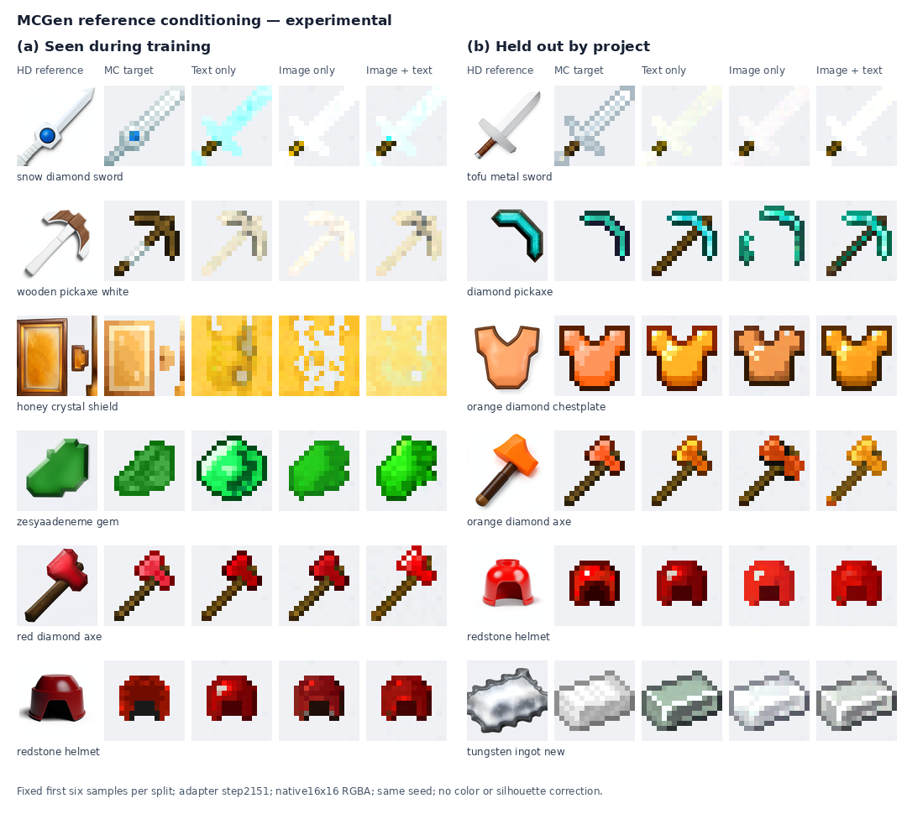

# 参考图生成抽样

训练内、训练外各六个固定样本，保留失败结果。列顺序：参考图、MC 原图、纯文本、纯参考图、图文联合。

`manifest.json` 保留文件名标签、项目、参考图来源和文件哈希；`generated/` 是原始16×16 RGBA输出。两种种子的参考图及图文结果一并保留。完整128个新物品的896张对照通过模型仓库分发。

[模型与完整对照](https://huggingface.co/datasets/Risposta/MC_Gen/tree/main/checkpoints/reference-step2151)
