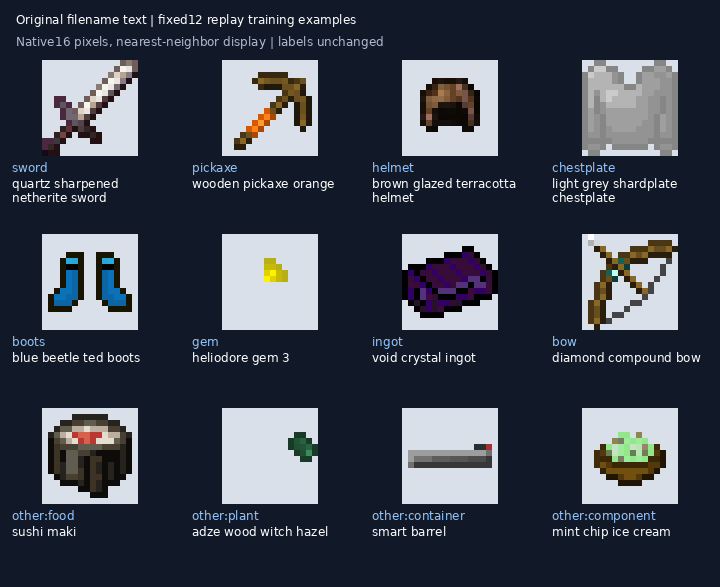

# 文生图回放数据抽样

从本轮2000张固定回放训练图中，取12个文字分组的首个样本，不按视觉效果挑选。原生图片均为16×16 RGBA，像素哈希与原目录一致。

[标签表](labels.csv) · [来源与哈希](manifest.json) · [训练方案](../../docs/REFERENCE_TEXT_REPLAY_20261108.md)

`images/00.png`等只是便于浏览的导出名。实际训练使用`prompt`，保留的来源文件名见`source_filename`，不能从这些导出名重新提取标签。文字分组仅用于抽样，不是视觉精标。

这里只保留少量审查样本，完整数据与特征缓存不随Git提交。
