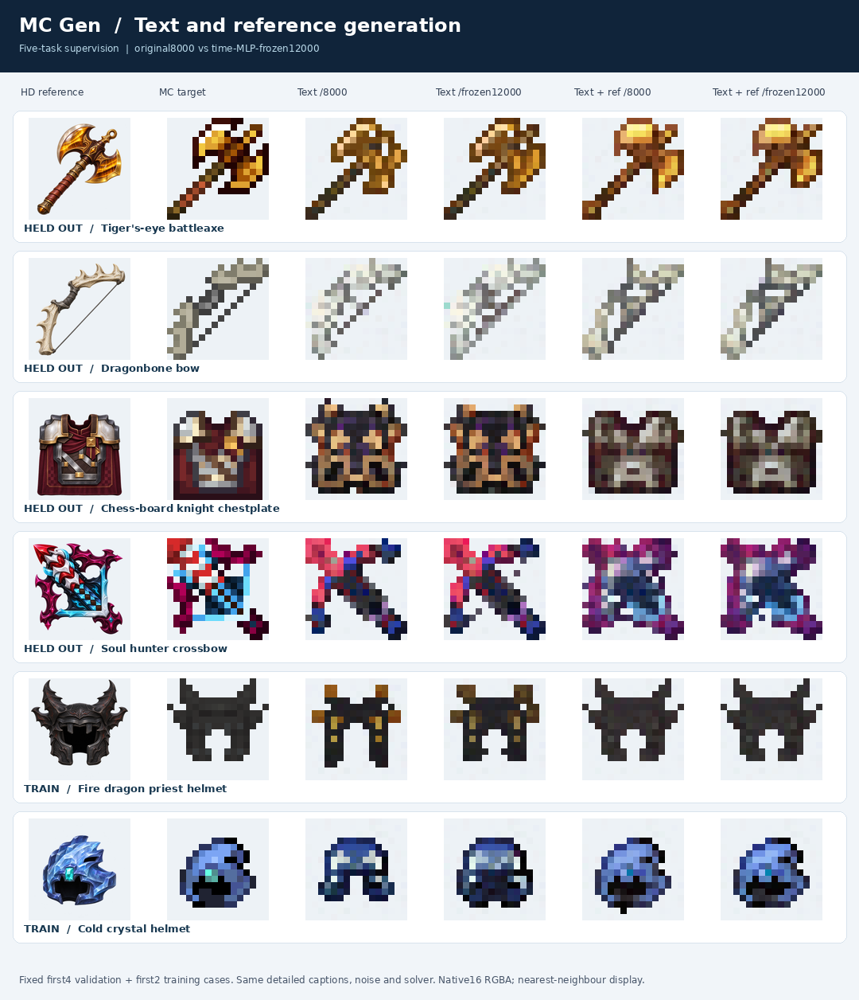

# 五任务与时间MLP冻结对照

固定取4个验证、2个训练目标，保留失败结果。比较未冻结的8000步与冻结时间MLP后续训4000步、到12000步的版本。

`manifest.json`包含粗标、精标、来源、划分与文件哈希。`inputs/`保留16格目标、可无损还原的32格来源和缩小展示的高清参考；`generated/`为原始16格输出。所有目标都核验为精确2倍重复，不含有损32→16候选。
